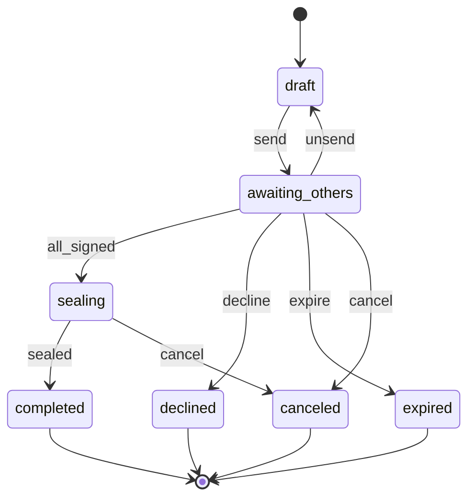
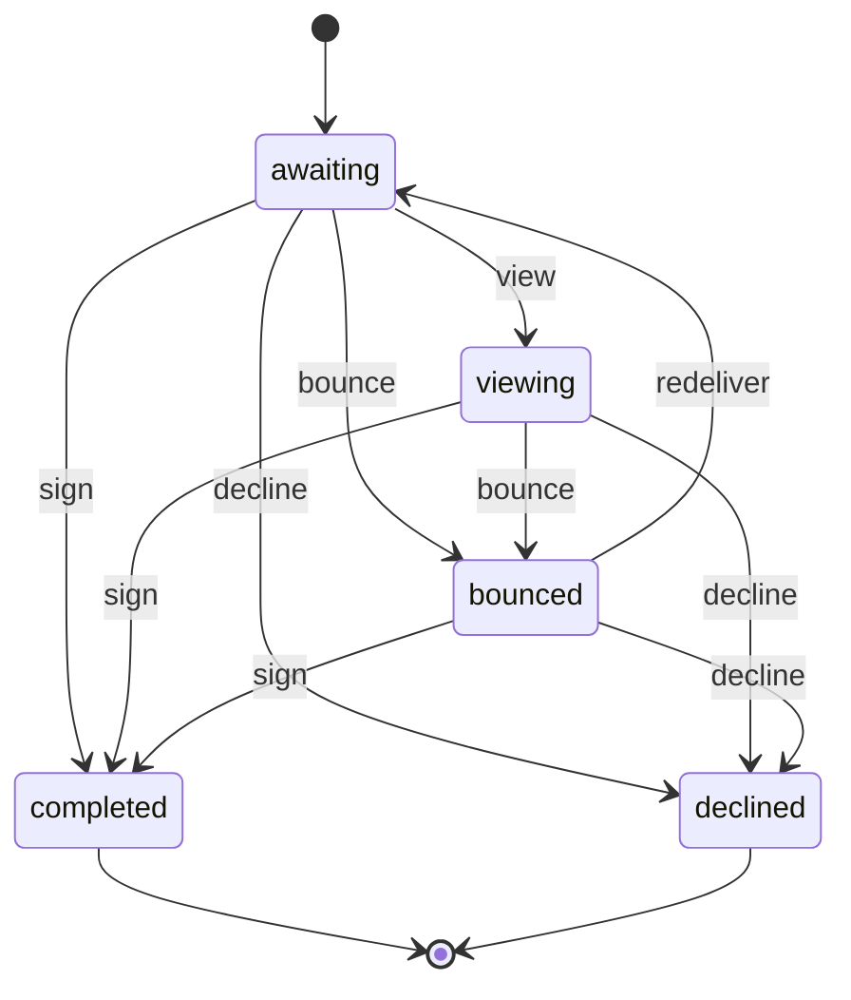
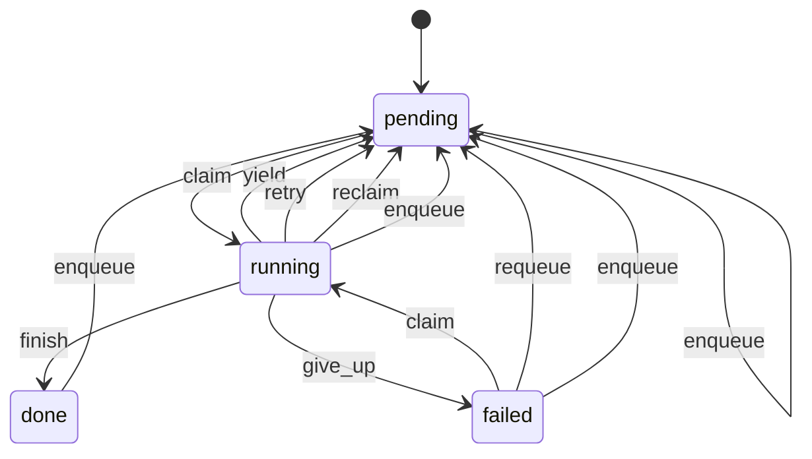
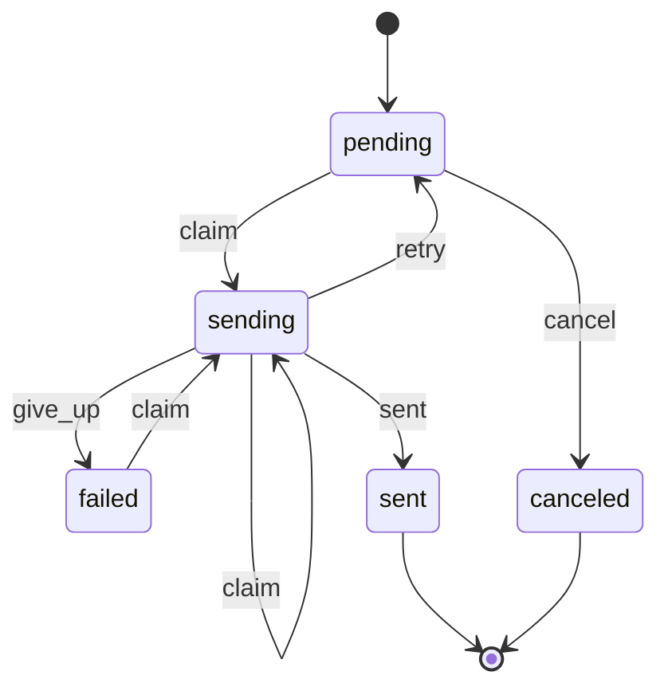
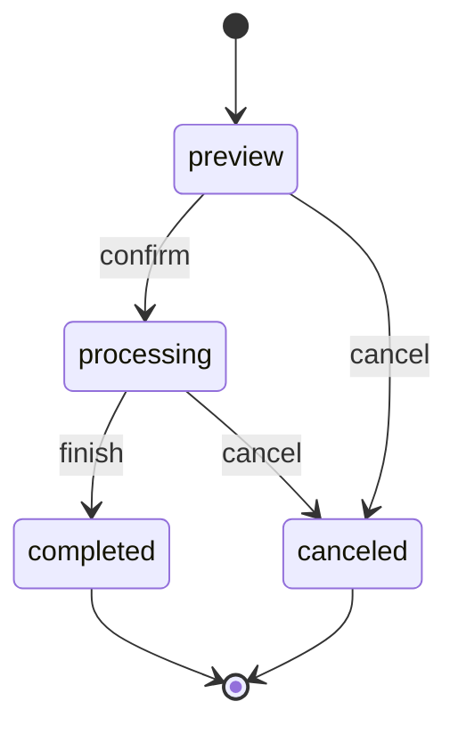
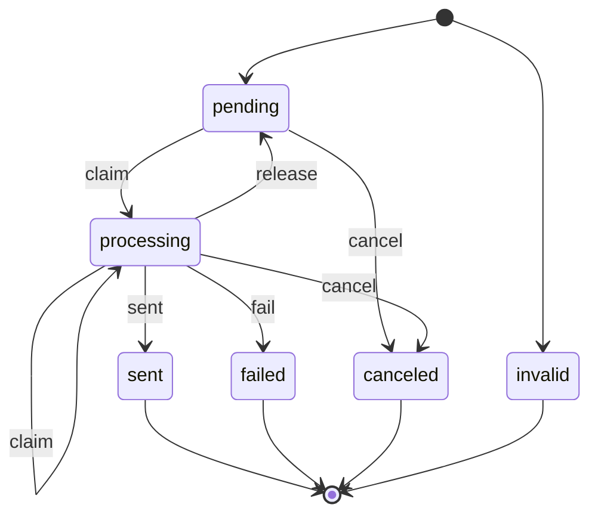
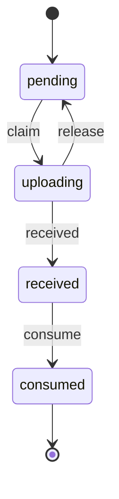
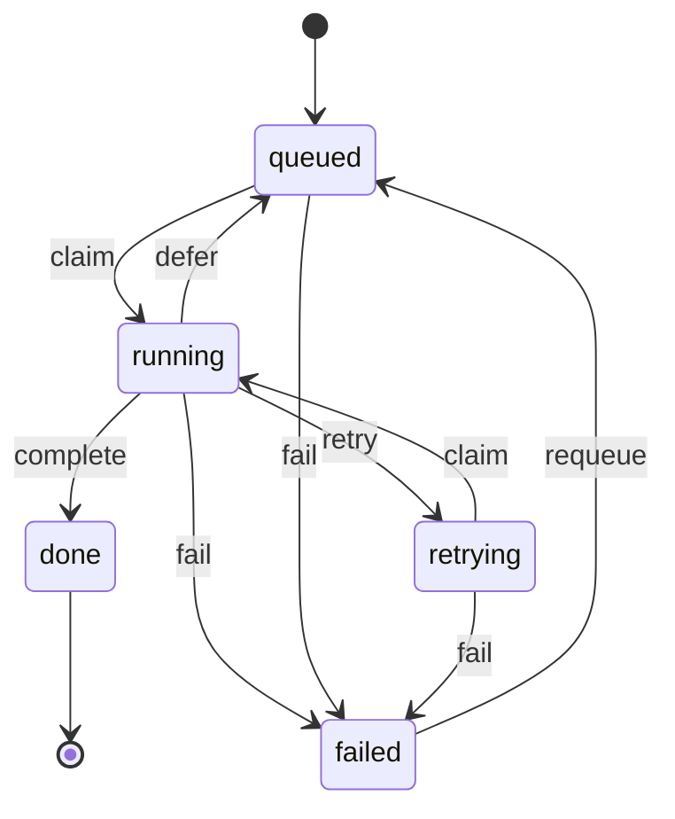
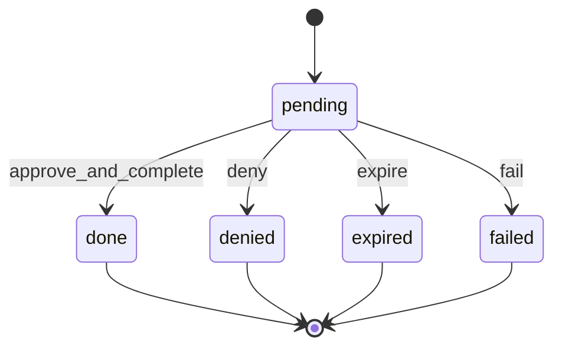

# State machines

<!-- Generated from packages/shared/src/state-machines/ by
     apps/api/src/__tests__/state-machines.spec.ts. Do not edit by hand:
     change the machine, then run
     UPDATE_STATE_MACHINE_DOCS=1 pnpm --filter api test -- state-machines -->

Every persisted lifecycle in seald is declared once, in
`packages/shared/src/state-machines/`, and code asks the machine instead of
comparing status strings:

- **Writes** guard on the declared source states:
  `.where('status', 'in', ENVELOPE_MACHINE.sources('cancel'))`. The
  row-conditional UPDATE is still the concurrency guard; the machine is the
  single place that says which rows qualify.
- **Gates** read `ENVELOPE_MACHINE.can(status, event)` for a transition and
  `ENVELOPE_MACHINE.allows(status, action)` for a status-gated action (edit a
  draft, remind, download the sealed PDF).
- **The SPA** shows only the actions `ownerEnvelopeActions(status)` returns.
- **Agents** get the same list as `allowed_actions` (and `terminal`) from the
  MCP tool `envelopes_status`.

Adding a state or an edge: change the machine, run the command above, and
let typecheck point at every `switch` that must handle it. `defineMachine`
refuses an unknown state, an edge out of a terminal state and an
unreachable state when the module loads.

## `envelope`

A request for signatures, from draft to a sealed PDF or a stopped request. Every write is row-conditional on `status IN ENVELOPE_MACHINE.sources(event)`.

Stored in `envelopes.status`. Initial: `draft`. Terminal: `completed`, `declined`, `expired`, `canceled`.

| Event | From | To | Meaning |
| --- | --- | --- | --- |
| `send` | `draft` | `awaiting_others` | The owner (or an agent) sends the draft; the first signers are invited. |
| `unsend` | `awaiting_others` | `draft` | The owner takes a just-sent request back inside the undo window, before any signer opened it. |
| `all_signed` | `awaiting_others` | `sealing` | The last signer signed; a seal job is queued. |
| `sealed` | `sealing` | `completed` | The seal worker stored the PAdES-sealed PDF and the audit trail. |
| `decline` | `awaiting_others` | `declined` | A signer declined to sign. |
| `expire` | `awaiting_others` | `expired` | The expiry sweep found `expires_at` in the past. |
| `cancel` | `awaiting_others`, `sealing` | `canceled` | The owner withdrew the request. |

| Action | Allowed in | Meaning |
| --- | --- | --- |
| `tag` | `draft`, `awaiting_others`, `sealing`, `completed`, `declined`, `expired`, `canceled` | Add or remove private tags (they are not part of the signed document). |
| `archive` | `draft`, `awaiting_others`, `sealing`, `completed`, `declined`, `expired`, `canceled` | Archive or restore (`archived_at`, orthogonal to the status). |
| `edit_draft` | `draft` | Change documents, signers, fields, signing order, title, expiry or other settings. |
| `delete` | `draft` | Delete the draft for good. |
| `toggle_reminders` | `draft`, `awaiting_others` | Turn automatic reminders on or off while signatures can still come in. |
| `extend_expiry` | `awaiting_others` | Move the expiry of a request that is out for signature (`expiry_changed` event). |
| `remind` | `awaiting_others` | Re-send the invite to a signer whose turn it is. |
| `correct_signer` | `awaiting_others` | Fix the name or email of a signer who has not acted yet. |
| `sign` | `awaiting_others` | A signer whose turn it is views, fills, signs or declines. |
| `download_sealed` | `completed` | Download the sealed PDF. |
| `download_declined_copy` | `declined`, `expired`, `canceled` | Download the stamped copy of a stopped request (audit-only seal). |

## `signer`

One recipient of an envelope. `bounced` is owner-facing only: signer and verify pages read it as `awaiting`.

Stored in `envelope_signers.{viewed_at, signed_at, declined_at, delivery_status} (derived by signerStatusOf)`. Initial: `awaiting`. Terminal: `completed`, `declined`.

| Event | From | To | Meaning |
| --- | --- | --- | --- |
| `view` | `awaiting` | `viewing` | The signer opened their link (`viewed_at`). |
| `sign` | `awaiting`, `viewing`, `bounced` | `completed` | The signer submitted every required field (`signed_at`). |
| `decline` | `awaiting`, `viewing`, `bounced` | `declined` | The signer declined (`declined_at`); the envelope is declined too. |
| `bounce` | `awaiting`, `viewing` | `bounced` | The mail provider reported a hard bounce (`delivery_status = bounced`). |
| `redeliver` | `bounced` | `awaiting` | The owner corrected the address and the invite went out again. Reads `viewing` if the signer had opened it before. |

## `seal_job`

Background sealing of one envelope: PAdES seal of each document, then the audit trail.

Stored in `envelope_jobs.status`. Initial: `pending`. Terminal: none.

| Event | From | To | Meaning |
| --- | --- | --- | --- |
| `claim` | `pending`, `failed` | `running` | A worker claims the oldest due row (`FOR UPDATE SKIP LOCKED`, attempts < max) and counts an attempt. |
| `yield` | `running` | `pending` | The edge worker finished one step and stores `progress`; the attempt is refunded. |
| `finish` | `running` | `done` | Every step finished. |
| `retry` | `running` | `pending` | A step threw with attempts left; rescheduled with exponential backoff. |
| `give_up` | `running` | `failed` | A step threw on the last attempt, or a stale run had no attempts left. |
| `reclaim` | `running` | `pending` | The seal sweep re-arms a run whose worker died (started too long ago). |
| `requeue` | `failed` | `pending` | The seal sweep re-arms a failed job that still has attempts. |
| `enqueue` | `pending`, `running`, `done`, `failed` | `pending` | Insert or re-arm the row for the envelope (resets attempts, error and progress). |

## `outbound_email`

One queued email. The dispatcher claims due rows (`FOR UPDATE SKIP LOCKED`, attempts < max). `failed` always has its attempts spent, so it is never claimed again.

Stored in `outbound_emails.status`. Initial: `pending`. Terminal: `sent`, `canceled`.

| Event | From | To | Meaning |
| --- | --- | --- | --- |
| `claim` | `pending`, `failed`, `sending` | `sending` | The dispatcher claims a due row with attempts left, counts an attempt and takes a 10-minute lease (`scheduled_for`). A `sending` row whose lease ran out (its dispatcher died) is claimed again. |
| `sent` | `sending` | `sent` | The provider accepted the email. |
| `retry` | `sending` | `pending` | A transient send error with attempts left; rescheduled with backoff. |
| `give_up` | `sending` | `failed` | A permanent error, the last attempt, an unknown template or a skipped send; attempts are set to max. Also a stale `sending` row with no attempts left. |
| `cancel` | `pending` | `canceled` | An invite or your-turn email whose envelope was taken back (unsend). |

## `bulk_batch`

One bulk send: a CSV of recipients previewed, confirmed and worked row by row.

Stored in `bulk_batches.status`. Initial: `preview`. Terminal: `completed`, `canceled`.

| Event | From | To | Meaning |
| --- | --- | --- | --- |
| `confirm` | `preview` | `processing` | The owner confirms a batch with at least one valid row. |
| `finish` | `processing` | `completed` | No row is pending or processing any more; the summary email goes out once. |
| `cancel` | `preview`, `processing` | `canceled` | The owner cancels; pending rows are canceled with it. |

| Action | Allowed in | Meaning |
| --- | --- | --- |
| `edit_options` | `preview` | Change the batch options before confirming. |

## `bulk_row`

One CSV row of a bulk batch. Rows that fail validation are created `invalid` and never sent.

Stored in `bulk_batch_rows.status`. Initial: `pending`, `invalid`. Terminal: `sent`, `failed`, `canceled`, `invalid`.

| Event | From | To | Meaning |
| --- | --- | --- | --- |
| `claim` | `pending`, `processing` | `processing` | The bulk worker claims a pending row, or reclaims one whose lock went stale, while the batch is processing. |
| `sent` | `processing` | `sent` | The envelope for the row was sent. |
| `fail` | `processing` | `failed` | The row could not be sent. |
| `release` | `processing` | `pending` | The worker hit the per-minute rate limit and hands the row back. |
| `cancel` | `pending`, `processing` | `canceled` | The batch was canceled: pending rows at once, a row a dead worker left `processing` once its lock is stale. |

## `scan_session`

"Scan with phone": a 10-minute hand-off from the phone to the computer. Expiry is read from `expires_at`; the public status reads `expired` for a consumed or timed-out session.

Stored in `scan_sessions.status`. Initial: `pending`. Terminal: `consumed`.

| Event | From | To | Meaning |
| --- | --- | --- | --- |
| `claim` | `pending` | `uploading` | The phone starts its single upload (session unexpired). |
| `received` | `uploading` | `received` | The PDF is stored. |
| `release` | `uploading` | `pending` | The upload failed; the phone may try again. |
| `consume` | `received` | `consumed` | The owner's browser downloaded the PDF. |

## `automation_run`

One delivery of a workflow automation (webhook or email copy) for one trigger.

Stored in `automation_runs.status`. Initial: `queued`. Terminal: `done`.

| Event | From | To | Meaning |
| --- | --- | --- | --- |
| `claim` | `queued`, `retrying` | `running` | The automation worker claims the due job. |
| `complete` | `running` | `done` | Delivered; the failure streak resets. |
| `retry` | `running` | `retrying` | A retryable failure with attempts left. |
| `defer` | `running` | `queued` | Rate or daily cap reached; tried again later without spending an attempt. |
| `fail` | `running`, `queued`, `retrying` | `failed` | Out of attempts or not retryable (streak +1), or parked (retryable) because the recipe changed, needs approval or was turned off. |
| `requeue` | `failed` | `queued` | The owner retries a failed, retryable run. |

## `approval`

An agent action waiting for the owner. Only an open row (nothing recorded, inside its 24 hours) decides.

Stored in `mcp_approvals.{approved_at, denied_at, failed_at, expired_at, completed_at, expires_at} (derived by approvalStatus)`. Initial: `pending`. Terminal: `done`, `denied`, `expired`, `failed`.

| Event | From | To | Meaning |
| --- | --- | --- | --- |
| `approve_and_complete` | `pending` | `done` | Approved and the action finished (`completed_at`). |
| `deny` | `pending` | `denied` | The owner denied it. |
| `expire` | `pending` | `expired` | Past `expires_at`, or expired because its key or grant was revoked (`expired_at`). |
| `fail` | `pending` | `failed` | The approved action failed, or did not finish within 10 minutes (`execution_interrupted`). |
